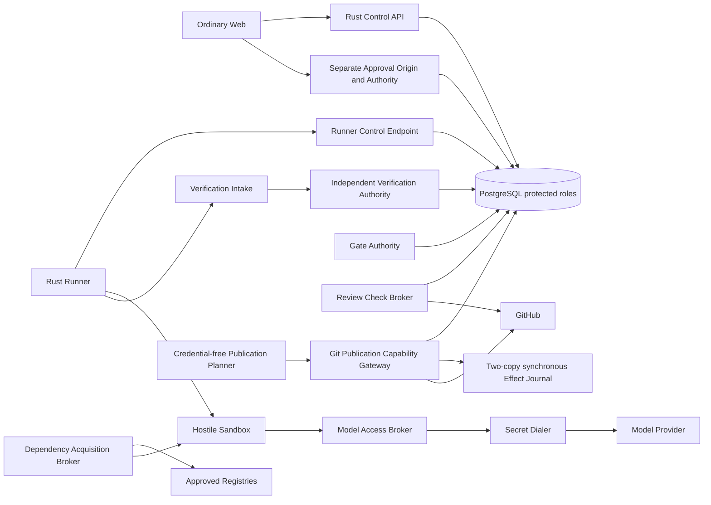

# Executive architecture

Mastercoder remains a local-first review and bounded fix-publication product: Rust/Axum/Tokio/SQLx/Serde backend, PostgreSQL authority, Next.js/React/TypeScript web, and customer-controlled Rust runner. PostgreSQL outbox, leases and fencing are the durable workflow default; Redis/Kafka/NATS/RabbitMQ are not required. V2.1 adds only boundaries needed to repair accepted findings.

Only trusted service endpoints hold scoped DB credentials. Gate Authority checks immutable producer-authenticated evidence, protected policy/current subject/trust and the complete expected analysis manifest. FAST deterministic review has no model prerequisite; AI/hybrid/deep modes extend it through bounded customer-owned model modes. C3 requires actual separate administrative domains, not two containers on one owner's host.

The Approval Authority fetches and renders the exact pinned plan/bytes itself, then verifies a fresh scoped WebAuthn ceremony. Its credential registration/recovery cannot be performed by ordinary account recovery. A credential-free planner requests publication; an independently administered credential-bearing gateway derives each allowed request, checks fresh authority for that effect and sends only after journal durability is confirmed. It verifies exact Git tree/ref/PR lineage. Gateway compromise or stolen provider token remains a broader provider-granted mutation risk.

Provider checks are explicitly reconciled projections. Internal revocation invalidates truth immediately but GitHub can retain a prior success during propagation. Normal policy changes stage behind confirmed freeze; emergency revocation exposes the unsafe interval and requests effective provider freeze while withdrawing success. No stale external success is represented as currently authoritative by Mastercoder.

The synchronous journal closes lost-intent recovery across RPO restores, with the stated independent failure-domain assumption. No send occurs when durability cannot be confirmed; ambiguous individual requests remain UNKNOWN/manual until proven. The original Rust/PostgreSQL topology is preserved with scoped security roles and this necessary recovery witness, not a new general workflow platform.
